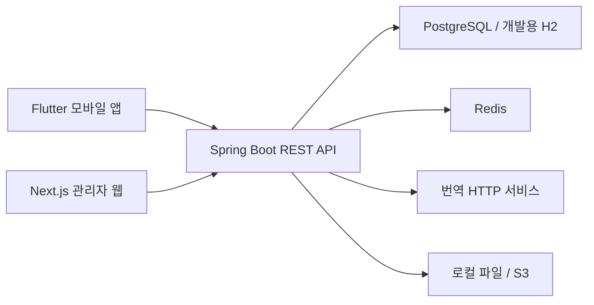

# Migram

다국어 커뮤니티를 위한 Flutter 앱과 Kotlin/Spring Boot 백엔드 프로젝트입니다. 게시글·댓글·투표·팔로우·채팅을 제공하는 구조에 번역, 검색, 알림, 신고 관리 기능을 함께 개발하고 있습니다.

**팀 프로젝트 · 주요 담당: 서비스 기획 및 백엔드 개발**

아래 기능과 구조는 팀 저장소 전체를 설명합니다. 프런트엔드와 모든 모듈을 단독 구현했다는 의미는 아닙니다.

## 먼저 살펴볼 코드

| 주제 | 구현과 확인 경로 |
| --- | --- |
| 번역 결과 재사용 | [TranslationService](server/backend/src/main/kotlin/com/example/backend/web/service/TranslationService.kt) · [DB 캐시 통합 테스트](server/backend/src/test/kotlin/com/example/backend/web/service/TranslationRedisFallbackIT.kt) |
| 모바일 로그인 연결 | [SecurityConfig](server/backend/src/main/kotlin/com/example/backend/web/config/SecurityConfig.kt) · [인증 코드 서비스](server/backend/src/main/kotlin/com/example/backend/web/service/AuthorizationCodeService.kt) |
| 검색과 환경별 구현 | [PostgreSQL 전문 검색](server/backend/src/main/kotlin/com/example/backend/web/service/FullTextSearchService.kt) · [개발 환경 검색](server/backend/src/main/kotlin/com/example/backend/web/service/DatabaseSearchService.kt) |
| 피드와 알림 | [개인화 피드](server/backend/src/main/kotlin/com/example/backend/web/service/PersonalizedFeedService.kt) · [알림 서비스](server/backend/src/main/kotlin/com/example/backend/web/service/NotificationService.kt) |
| 데이터 모델 | [엔티티](server/backend/src/main/kotlin/com/example/backend/web/model) · [DB 마이그레이션](server/backend/src/main/resources/db/migration) |

## 기술 구성

| 영역 | 구성 |
| --- | --- |
| 백엔드 | JDK 17, Kotlin 1.8.22, Spring Boot 3.1.3, Spring Security, JPA |
| 데이터 | PostgreSQL, Redis, Flyway · 개발 프로필은 H2 |
| 모바일 | Flutter, Dart SDK `>=3.4.4 <4.0.0`, Dio |
| 관리자 웹 | Next.js 16, React 19, TypeScript |
| 번역 연동 | HTTP API · 개발용 Python/Flask 모의 서버 |
| 파일 저장 | 개발 환경 로컬 파일 / 운영 프로필 AWS S3 |
| 검증 | JUnit 5, Testcontainers, MockWebServer, GitHub Actions |

버전과 의존성의 기준은 [Gradle 설정](server/backend/build.gradle.kts), [Flutter 설정](frontend/migram_app/pubspec.yaml), [관리자 웹 설정](admin/package.json)입니다.

## 시스템 구조



번역 결과는 DB의 `content_translation`에 저장합니다. Redis는 다른 캐시 기능의 구성 요소이며, 현재 `TranslationService`는 Redis를 직접 사용하지 않습니다.

## 백엔드 구현 포인트

### 1. 번역 API 호출과 DB 캐시

원문과 대상 언어가 같으면 원문을 반환하고, 다르면 DB에 저장된 번역을 먼저 조회합니다. 캐시가 없을 때 번역 HTTP API를 호출하고 결과를 저장합니다.

[통합 테스트](server/backend/src/test/kotlin/com/example/backend/web/service/TranslationRedisFallbackIT.kt)는 PostgreSQL 컨테이너와 MockWebServer를 이용해 저장된 번역 재사용, API 호출 횟수, 동일 언어 요청 처리를 확인하도록 작성되어 있습니다. 테스트 클래스 이름에 남은 `RedisFallback`은 이전 명칭이며 현재 구현은 DB 캐시 방식입니다.

### 2. 모바일 OAuth 연결

Google OAuth 로그인 성공 후 일회용 인증 코드를 모바일 딥링크로 전달하고 토큰 교환 흐름으로 연결합니다. [보안 설정](server/backend/src/main/kotlin/com/example/backend/web/config/SecurityConfig.kt), [인증 코드 처리](server/backend/src/main/kotlin/com/example/backend/web/service/AuthorizationCodeService.kt), [앱 딥링크 처리](frontend/migram_app/lib/services/deep_link_service.dart)를 함께 읽을 수 있습니다.

### 3. 개발 환경과 PostgreSQL 검색 분리

`dev` 프로필에서는 H2용 검색 구현을 사용하고, 그 외 프로필에서는 PostgreSQL 전문 검색 구현을 사용합니다. 현재 전문 검색 서비스는 조회 이후 일부 필터·정렬·페이지 처리를 메모리에서 수행하므로, 대규모 데이터 처리 성능까지 검증된 구조로 설명하지 않습니다.

## 로컬 개발

### 백엔드

필요 환경은 JDK 17과 Redis입니다. Google 로그인을 확인하려면 별도의 개발용 OAuth 클라이언트와 리디렉션 URI 설정이 필요합니다.

1. [기본 설정](server/backend/src/main/resources/application.yml)과 [개발 설정](server/backend/src/main/resources/application-dev.yml)을 확인합니다.
2. 실행 셸 또는 로컬 환경 파일에 `SPRING_PROFILE=dev`, `JWT_SECRET_KEY`, `GOOGLE_CLIENT_ID`, `GOOGLE_CLIENT_SECRET`을 설정합니다. AWS 관련 기본 설정을 해석할 수 있도록 `S3_REGION`, `S3_ACCESS_KEY`, `S3_SECRET_KEY`도 확인합니다. 개발 프로필의 파일 저장소는 로컬이며 S3 클라이언트는 `storage.type=s3`일 때 생성됩니다.
3. 저장소 루트에서 실행합니다.

```bash
cd server/backend
./gradlew bootRun --args='--spring.profiles.active=dev'
```

API 기본 포트는 `8080`입니다. 개발 프로필은 파일 기반 H2, Hibernate 스키마 갱신, 로컬 업로드를 사용하고 Flyway를 끕니다. 운영 프로필은 PostgreSQL과 스키마 검증을 사용합니다.

[환경 변수 예시](server/.env.example)의 DB URL에는 이전 MySQL 예시가 남아 있습니다. 현재 운영 설정의 기준은 [application-prod.yml](server/backend/src/main/resources/application-prod.yml)의 PostgreSQL이며, 예시 파일을 그대로 복사한 것만으로 실행 준비가 완료되지는 않습니다.

### 번역 연동 확인

현재 개발 설정은 `http://localhost:5001`을 사용합니다. 다음 서버는 실제 번역 모델 대신 대상 언어 접두사를 붙이는 **모의 응답**을 반환합니다.

```bash
cd server/translation
python3 -m venv .venv
source .venv/bin/activate
python -m pip install Flask
python translation.py
```

실제 번역 품질이나 모델 성능은 이 서버로 검증할 수 없습니다. 별도 [translation-service](translation-service) 디렉터리도 있으므로, 교체할 때 요청·응답 계약과 포트를 확인해야 합니다.

### 모바일·관리자 웹

모바일은 먼저 [AppConfig](frontend/migram_app/lib/config.dart)의 개발용 서버 주소와 ngrok 사용 여부를 본인 환경에 맞춥니다.

```bash
cd frontend/migram_app
flutter pub get
flutter run
```

관리자 웹은 별도 터미널에서 실행합니다.

```bash
cd admin
npm ci
npm run dev
```

`NEXT_PUBLIC_API_URL`의 기본값은 `http://localhost:8080`입니다. 현재 [관리자 API 클라이언트](admin/src/lib/api.ts)에 인증 토큰 연결 TODO가 남아 있어 관리자 인증 전체 흐름은 추가 확인이 필요합니다.

## 테스트

JDK 17과 실행 중인 Docker가 필요합니다. 아래 명령은 저장소 루트 기준입니다.

```bash
cd server/backend
./gradlew test --tests '*TranslationRedisFallbackIT' --no-daemon
# 전체 백엔드 테스트
./gradlew test --no-daemon
```

- [번역 캐시 테스트 안내](server/backend/src/test/kotlin/com/example/backend/web/service/README_TranslationRedisFallbackIT.md)
- [검색·알림·피드 등 통합 테스트](server/backend/src/test/kotlin/com/example/backend/web/service)
- [GitHub Actions 설정](.github/workflows/integration-test.yml)

현재 루트 CI는 번역 캐시 테스트를 대상으로 하며 해당 실행 단계에 `continue-on-error: true`가 있습니다. 워크플로 상태만으로 전체 테스트 통과를 판단하지 않고 테스트 보고서와 로그를 함께 확인해야 합니다.

## 현재 상태

이 문서는 코드와 설정을 기준으로 정리한 개발 안내입니다. 문서 정리 과정에서 앱 실행, 실서비스 배포, 전체 테스트 통과 또는 처리 성능을 새로 검증하지 않았습니다. 번역 모델 교체, 관리자 인증 연결, 환경 설정 정합성, 검색 처리 규모는 후속 확인 항목입니다.

문서 정리: 2026-11-13. 실제 개발 이력은 기존 커밋과 PR에 보존합니다.
