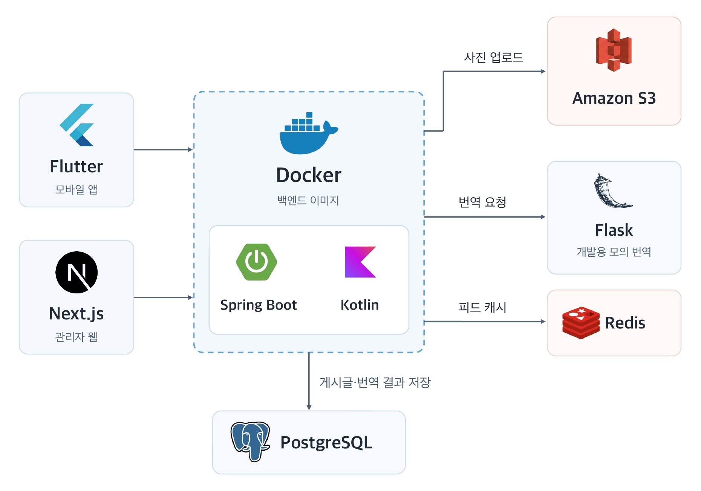
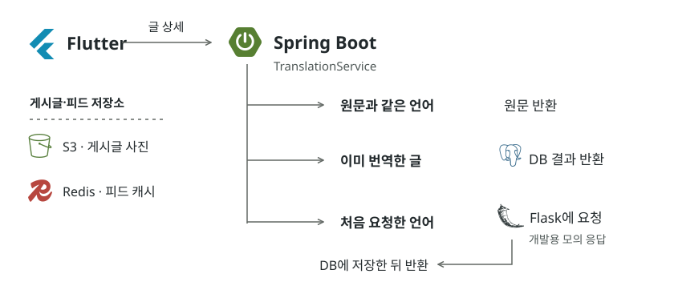

# Migram

Migram은 국가별 게시판에서 사진과 글을 나누는 커뮤니티 앱으로, 팀 프로젝트로 개발했습니다. 서로 다른 언어를 쓰는 사용자들이 같은 대화에 참여할 수 있도록 게시글과 댓글에 번역 기능을 기획했습니다.

## 게시판과 피드

피드에서는 사용자가 팔로우한 작성자의 글과 사용자 국가에 해당하는 게시판의 글에 가중치를 줍니다. 게시글 상세 화면에서 원문을 확인하고 번역을 요청할 수 있습니다. [글 작성 화면](frontend/migram_app/lib/screens/create_post_screen.dart) · [피드 정렬](server/backend/src/main/kotlin/com/example/backend/web/service/PersonalizedFeedService.kt) · [글 상세 화면](frontend/migram_app/lib/screens/post_detail_screen.dart)

개발용 Flask 서버는 원문 앞에 요청한 언어를 표시해 반환합니다. 번역 결과의 저장과 재사용을 검증할 때는 미리 정한 번역문을 돌려주는 모의 API를 사용했습니다. [개발용 번역 서버](server/translation/translation.py) · [번역 처리](server/backend/src/main/kotlin/com/example/backend/web/service/TranslationService.kt)

## 전체 아키텍처

Redis는 사용자별 피드를 캐시하고 PostgreSQL은 게시글과 번역 결과를 저장합니다. 운영 설정에서는 서버가 사진 크기를 조정해 S3에 올립니다. 관리자 웹의 신고 API에는 인증 토큰을 연결하는 작업이 남아 있습니다. [사진 저장](server/backend/src/main/kotlin/com/example/backend/web/service/S3Service.kt) · [백엔드 Dockerfile](server/Dockerfile.backend) · [관리자 API](admin/src/lib/api.ts)

## 번역 결과 저장과 재사용

서버는 원문과 요청 언어가 같을 때 원문을 그대로 반환합니다. 다른 언어로 읽을 때는 콘텐츠 종류(게시글 또는 댓글), ID, 요청 언어로 기존 번역을 찾습니다. 저장된 결과가 없을 때만 번역 API를 호출합니다.

Testcontainers로 PostgreSQL을 실행한 뒤 영어 게시글 한 건을 등록했습니다. 아래는 각 요청에서 받은 응답과 모의 번역 API 호출 횟수입니다.

| 요청 | 응답 | 번역 API 추가 호출 |
| --- | --- | --- |
| 처음 한국어로 읽기 | 모의 API 응답을 저장하고 반환 | 1회 |
| 다시 한국어로 읽기 | DB에서 읽은 결과 반환 | 0회 |
| 원문 언어인 영어로 읽기 | 원문 반환 | 0회 |

첫 번째 한국어 요청이 끝난 뒤 JPA의 변경 사항을 DB에 반영하고 영속성 컨텍스트를 비웠습니다. 두 번째 요청에서는 DB에 저장한 번역을 읽었고 모의 API 호출 횟수는 늘지 않았습니다. [통합 테스트](server/backend/src/test/kotlin/com/example/backend/web/service/TranslationRedisFallbackIT.kt) · [테스트 4개 통과 기록](https://github.com/DuckCow/migram/actions/runs/43393293230)

## 댓글 삭제 후 답글 유지

서버는 삭제한 댓글의 본문을 안내 문구로 바꾸고 삭제 여부를 기록합니다. 댓글 행이 남아 있어 기존 답글과의 연결도 유지됩니다. [삭제 처리](server/backend/src/main/kotlin/com/example/backend/web/service/CommentService.kt) · [댓글 응답](server/backend/src/main/kotlin/com/example/backend/web/model/Extensions.kt)
